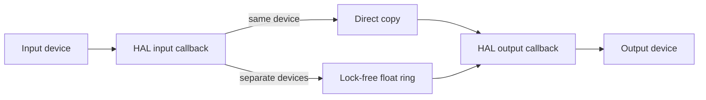

# Architecture

## Overview

Headphone Monitor is a menu-bar application with a small C audio engine embedded in Objective-C UI code.

## Device Discovery

The app enumerates CoreAudio devices through `kAudioHardwarePropertyDevices`, filters them by stream configuration, and reads each device's name, nominal sample rate, stream format, and buffer-frame range.

Only linear PCM float32 streams are accepted. Input and output nominal sample rates must match exactly within 0.5 Hz.

## Same-Device Path

When the selected input and output use one `AudioDeviceID`, a single `AudioDeviceCreateIOProcID` callback receives both input and output buffers.

The callback:

1. Copies buffers directly when input and output layouts match
2. Otherwise maps the first input channel to every output channel
3. Returns immediately

There is no application queue in this path.

## Separate-Device Bridge

Separate devices use two HAL callbacks and a single-producer, single-consumer ring buffer.

- Input callback writes the first input channel as float32 mono
- Output callback reads frames and duplicates the mono signal across output channels
- Capacity is 16,384 frames
- Initial target is two output device buffers
- Drift handling discards one old frame when occupancy exceeds the target by two output buffers

The bridge is allocated before either callback starts. Ring indices are C11 atomics with acquire/release ordering.

## Startup And Shutdown

The input callback starts first. For separate devices, output starts only after the bridge contains at least its target frame count. Shutdown stops the device, then destroys the I/O procedure and frees bridge memory.

## Processing Boundary

The application does not create an AudioUnit, AVAudioEngine graph, or voice-processing unit. It does not resample, amplify, filter, gate, denoise, record, or persist samples.

CoreAudio, the selected driver, Bluetooth, AirPlay, and physical hardware remain below or above this boundary and cannot be bypassed through the public HAL API available to a sandboxed app.

Apple documents microphone-mode processing as part of its voice-processing APIs. The public bypass property applies to `AUVoiceProcessingIO`, which this project intentionally does not use.

## Failure Modes

- Unsupported stream format: return a clear start error
- Sample-rate mismatch: refuse to start rather than resample
- No input data after start: stop callbacks and report microphone permission or device failure
- Output underrun: repeat the most recent sample for the missing frames
- Device removal: surface the CoreAudio error and require a new device selection
