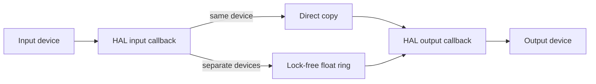

# Architecture

## Overview

Headphone Monitor is a menu-bar application with a small C audio engine embedded in Objective-C UI code.

## Device Discovery

The app enumerates CoreAudio devices through `kAudioHardwarePropertyDevices`, filters them by stream configuration, and reads each device's name, nominal sample rate, stream format, and buffer-frame range.

Only linear PCM float32 streams are accepted. Input and output nominal sample rates must match exactly within 0.5 Hz.

Buffer requests are clamped to each driver's advertised range. The minimum request uses `ceil(range.mMinimum)` independently for input and output, reported as actual negotiated frame counts after start.

## Same-Device Path

When the selected input and output use one `AudioDeviceID`, a single `AudioDeviceCreateIOProcID` callback receives both input and output buffers.

The callback:

1. Copies buffers directly when input and output layouts match
2. Otherwise maps the first input channel to every output channel
3. Returns immediately

There is no application queue in this path.

## Separate-Device Bridge

Separate devices use two HAL callbacks and a single-producer, single-consumer ring buffer.

- Input callback writes the first input channel as float32 mono
- Output callback reads frames directly from the ring and duplicates the mono signal across output channels
- Capacity is 16,384 frames
- Initial target is one input buffer plus one output buffer
- The first output callback discards stale pre-roll beyond the target instead of replaying frames accumulated while output starts
- Drift handling discards one old frame when occupancy exceeds the target by one input buffer plus one output buffer

The bridge is allocated before either callback starts. Ring indices are C11 atomics with acquire/release ordering. A separate scratch buffer is not used; mono output uses segmented `memcpy`, stereo output uses a two-channel fill loop, and other layouts use a bounded channel loop.

## Startup And Shutdown

The input callback starts first. For separate devices, output starts only after the bridge contains at least its target frame count. Shutdown stops the device, then destroys the I/O procedure and frees bridge memory.

## Performance Counters

The real-time callbacks record fixed-size metrics through C11 atomics:

- Callback invocation counts
- Monotonic time spent copying or bridging frames
- Callback work exceeding one buffer period
- Callback host-time gaps exceeding the expected period plus a fixed jitter allowance
- Ring-buffer overflow, underrun, and drift-correction frames
- Stale frames trimmed from the initial bridge prefill
- `kAudioDeviceProcessorOverload` property notifications

The main thread samples these counters once per second and updates the menu. It computes callback rates, average work, and bridge occupancy without affecting audio deadlines.

Each menu row carries an explicit `INFO`, `OK`, `WARN`, or `ERROR` label. The summary derives from individual counter thresholds, and the status icon changes to an orange warning triangle or red error octagon while monitoring.

The counters describe application-visible symptoms. They do not expose driver-internal drops or hardware glitches that never produce a late callback or CoreAudio overload notification.

## Latency Floor

The direct path adds no application buffer between HAL input and output. Its floor is determined by the selected device's input and output buffer periods, safety offsets, stream latency, driver, transport, and hardware conversion.

The separate-device bridge adds one input buffer plus one output buffer of prefill because the two HAL callbacks are independent. Reducing that target to one output buffer would remove a buffer period but can underrun before the next input callback; the additional output-buffer margin covers callback phase and scheduling jitter.

The public HAL API does not allow an application to reduce a read-only safety offset or device latency. Creating an aggregate device could fold both callbacks into one device, but it would add a clock domain plus subdevice drift compensation and possible hidden conversion outside the current explicit bridge model.

## Processing Boundary

The application does not create an AudioUnit, AVAudioEngine graph, or voice-processing unit. It does not resample, amplify, filter, gate, denoise, record, or persist samples.

CoreAudio, the selected driver, Bluetooth, AirPlay, and physical hardware remain below or above this boundary and cannot be bypassed through the public HAL API available to a sandboxed app.

Apple documents microphone-mode processing as part of its voice-processing APIs. The public bypass property applies to `AUVoiceProcessingIO`, which this project intentionally does not use.

## Failure Modes

- Unsupported stream format: return a clear start error
- Sample-rate mismatch: refuse to start rather than resample
- No input data after start: stop callbacks and report microphone permission or device failure
- Output underrun: repeat the most recent sample for the missing frames
- Device removal: surface the CoreAudio error and require a new device selection
